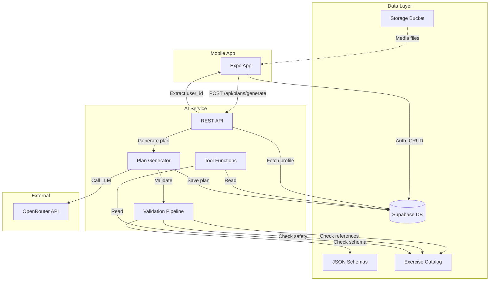
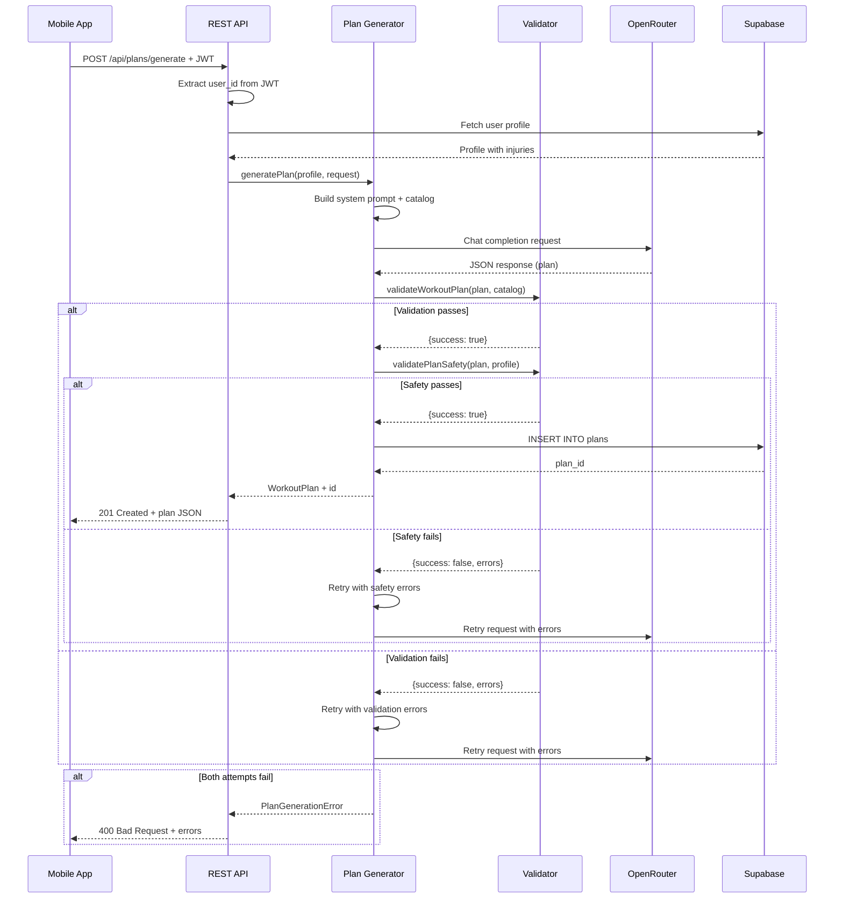
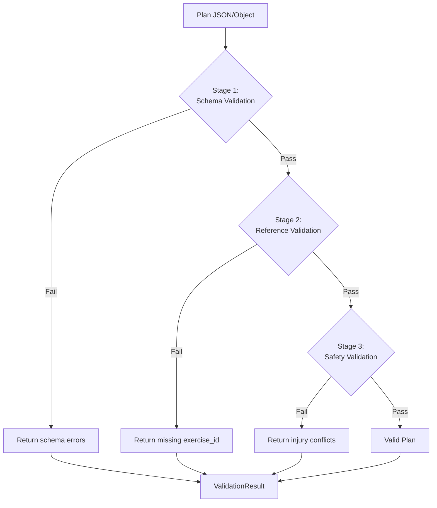

# Design Document

## Overview

The Contracts and Validation Foundation establishes the core data structures, schemas, and validation system for Aura Fit v2. This system enforces correctness through a layered validation approach: JSON Schema validation for structural correctness, catalog reference validation for exercise existence, and safety validation for injury constraints. The architecture follows a contracts-first approach where JSON schemas serve as the single source of truth for all system components.

The foundation consists of four major subsystems:

1. **Schema and Catalog System**: JSON Schema definitions (draft 2020-12) and the exercise catalog that define valid data structures
2. **Validation Pipeline**: Multi-stage validation ensuring plans are schema-valid, reference-valid, and safety-compliant
3. **AI Service**: OpenRouter-based plan generator that produces validated workout plans
4. **Backend Data Layer**: Supabase database with Row Level Security for user data isolation

This design ensures that invalid or unsafe workout plans can never reach users, as validation is enforced at multiple checkpoints with clear failure modes and error reporting.

## Architecture

### System Context



### Component Architecture

The system is organized into three main layers:

**Layer 1: Contracts (Read-Only Foundation)**
- JSON Schemas define valid structure
- Exercise Catalog defines available exercises
- TypeScript types generated from schemas
- No runtime modifications allowed

**Layer 2: Validation and Business Logic**
- Schema Validator (Ajv-based)
- Reference Validator (catalog lookups)
- Safety Validator (injury checking)
- Parser and pretty printer for serialization

**Layer 3: Application Services**
- REST API endpoint (Express/Fastify)
- OpenRouter Assistant (LLM integration)
- Tool functions (data access)
- Error handlers and loggers

### Data Flow: Plan Generation



### Validation Pipeline Architecture



## Components and Interfaces

### 1. Schema Definitions

**Exercise Schema** (`schemas/exercise.schema.json`)

The exercise schema enforces structural correctness for catalog entries:

```typescript
interface Exercise {
  id: string;                    // snake_case identifier
  group: ExerciseGroup;          // enum: warm_up, lower_body, upper_body, core, cardio
  name_key: string;              // Localization key (dot notation)
  body_parts: string[];          // Body parts targeted
  level: 1 | 2 | 3;             // Difficulty level
  unit: "reps" | "seconds";     // Measurement unit
  default: {
    sets: number;                // Positive integer
    amount: number;              // Positive integer (reps or seconds)
    rest_seconds: number;        // Non-negative integer
  };
  met: number;                   // MET value (1.0-15.0)
  avoid_if: string[];            // Injury identifiers (snake_case)
  quiet: boolean;                // Can be done silently
  media: {
    video: string;               // Filename in Storage
    poster: string;              // Filename in Storage
    model: string;               // Filename in Storage
  };
}

type ExerciseGroup = "warm_up" | "lower_body" | "upper_body" | "core" | "cardio";
```

**Workout Plan Schema** (`schemas/workout-plan.schema.json`)

The workout plan schema defines the complete structure of a multi-day workout program:

```typescript
interface WorkoutPlan {
  schema_version: string;        // Semver (e.g., "1.0.0")
  id: string;                    // UUID
  created_at: string;            // ISO 8601 datetime
  goal: string;                  // User's fitness goal
  days: WorkoutDay[];            // Non-empty array
  notes: string;                 // AI-generated notes
}

interface WorkoutDay {
  day: number;                   // Positive integer (1-based)
  title: string;                 // Day description
  minutes: number;               // Estimated duration
  blocks: WorkoutBlock[];        // Non-empty array
}

interface WorkoutBlock {
  type: "warm_up" | "main" | "cool_down";
  items: ExerciseItem[];         // Non-empty array
}

interface ExerciseItem {
  exercise_id: string;           // Must exist in catalog
  sets: number;                  // Positive integer
  amount: number;                // Positive integer (reps or seconds)
  rest_seconds?: number;         // Optional, non-negative
}
```

### 2. Validation Module

**Core Validation Interface**

```typescript
// Validation result types
interface ValidationResult {
  success: boolean;
  errors: ValidationError[];
}

interface ValidationError {
  path: string;                  // JSON path to error (e.g., "days[0].blocks[1].items[2]")
  message: string;               // Human-readable error
  code: string;                  // Error code for programmatic handling
}

interface SafetyValidationResult {
  success: boolean;
  violations: SafetyViolation[];
}

interface SafetyViolation {
  exercise_id: string;
  injury: string;
  location: string;              // Path in plan
}

// Main validation functions
function validateWorkoutPlan(
  plan: unknown,
  catalog: Exercise[]
): ValidationResult;

function validatePlanSafety(
  plan: WorkoutPlan,
  profile: Profile,
  catalog: Exercise[]
): SafetyValidationResult;
```

**Validation Implementation Strategy**

The validation module uses a three-stage pipeline:

1. **Schema Validation (Ajv)**
   - Compiled JSON Schema validators
   - Fast structural validation
   - Detailed error paths
   - Validates: types, required fields, enums, formats, ranges

2. **Reference Validation**
   - Build exercise_id index from catalog
   - Walk plan tree collecting all exercise_id references
   - Check each reference exists in index
   - Report missing exercises with location path

3. **Safety Validation**
   - Build injury index from user profile
   - For each exercise in plan, check avoid_if array
   - Flag any intersection with user injuries
   - Report conflicts with exercise and injury

**Validation Module Structure**

```typescript
// validator/index.ts
export { validateWorkoutPlan, validatePlanSafety } from './validate';
export { parseWorkoutPlan, formatWorkoutPlan } from './serialize';
export type { ValidationResult, SafetyValidationResult } from './types';

// validator/validate.ts
import Ajv from 'ajv';
import addFormats from 'ajv-formats';
import workoutPlanSchema from '../../schemas/workout-plan.schema.json';

const ajv = new Ajv({ allErrors: true, verbose: true });
addFormats(ajv);
const validateSchema = ajv.compile(workoutPlanSchema);

export function validateWorkoutPlan(
  plan: unknown,
  catalog: Exercise[]
): ValidationResult {
  // Stage 1: Schema validation
  const schemaValid = validateSchema(plan);
  if (!schemaValid) {
    return {
      success: false,
      errors: transformAjvErrors(validateSchema.errors)
    };
  }
  
  // Stage 2: Reference validation
  const typedPlan = plan as WorkoutPlan;
  const catalogIndex = buildCatalogIndex(catalog);
  const referenceErrors = validateReferences(typedPlan, catalogIndex);
  
  if (referenceErrors.length > 0) {
    return {
      success: false,
      errors: referenceErrors
    };
  }
  
  return { success: true, errors: [] };
}

export function validatePlanSafety(
  plan: WorkoutPlan,
  profile: Profile,
  catalog: Exercise[]
): SafetyValidationResult {
  const violations: SafetyViolation[] = [];
  const catalogMap = new Map(catalog.map(ex => [ex.id, ex]));
  const userInjuries = new Set(profile.injuries || []);
  
  // Walk plan tree
  for (const [dayIdx, day] of plan.days.entries()) {
    for (const [blockIdx, block] of day.blocks.entries()) {
      for (const [itemIdx, item] of block.items.entries()) {
        const exercise = catalogMap.get(item.exercise_id);
        if (!exercise) continue; // Already caught by reference validation
        
        // Check for injury conflicts
        for (const injury of exercise.avoid_if) {
          if (userInjuries.has(injury)) {
            violations.push({
              exercise_id: item.exercise_id,
              injury,
              location: `days[${dayIdx}].blocks[${blockIdx}].items[${itemIdx}]`
            });
          }
        }
      }
    }
  }
  
  return {
    success: violations.length === 0,
    violations
  };
}

// Helper: Build fast lookup index
function buildCatalogIndex(catalog: Exercise[]): Set<string> {
  return new Set(catalog.map(ex => ex.id));
}

// Helper: Validate all exercise references
function validateReferences(
  plan: WorkoutPlan,
  catalogIndex: Set<string>
): ValidationError[] {
  const errors: ValidationError[] = [];
  
  for (const [dayIdx, day] of plan.days.entries()) {
    for (const [blockIdx, block] of day.blocks.entries()) {
      for (const [itemIdx, item] of block.items.entries()) {
        if (!catalogIndex.has(item.exercise_id)) {
          errors.push({
            path: `days[${dayIdx}].blocks[${blockIdx}].items[${itemIdx}].exercise_id`,
            message: `Exercise '${item.exercise_id}' not found in catalog`,
            code: 'EXERCISE_NOT_FOUND'
          });
        }
      }
    }
  }
  
  return errors;
}

// Helper: Transform Ajv errors to our format
function transformAjvErrors(ajvErrors: any[]): ValidationError[] {
  return ajvErrors.map(err => ({
    path: err.instancePath || 'root',
    message: err.message || 'Validation failed',
    code: 'SCHEMA_VALIDATION_ERROR'
  }));
}
```

### 3. Serialization Module

**Parser and Pretty Printer**

```typescript
// validator/serialize.ts
interface ParseResult<T> {
  success: boolean;
  data?: T;
  error?: string;
}

export function parseWorkoutPlan(json: string): ParseResult<WorkoutPlan> {
  try {
    const parsed = JSON.parse(json);
    return { success: true, data: parsed as WorkoutPlan };
  } catch (error) {
    return {
      success: false,
      error: error instanceof Error ? error.message : 'Parse error'
    };
  }
}

export function formatWorkoutPlan(plan: WorkoutPlan): string {
  return JSON.stringify(plan, null, 2);
}
```

### 4. Exercise Catalog

**Catalog Structure** (`catalog/exercises.json`)

```json
{
  "version": "1.0.0",
  "exercises": [
    {
      "id": "neck-rolls",
      "group": "warm_up",
      "name_key": "exercise.neck_rolls.name",
      "body_parts": ["neck"],
      "level": 1,
      "unit": "reps",
      "default": {
        "sets": 1,
        "amount": 5,
        "rest_seconds": 0
      },
      "met": 2.0,
      "avoid_if": ["neck_injury"],
      "quiet": true,
      "media": {
        "video": "neck-rolls.mp4",
        "poster": "neck-rolls.jpg",
        "model": "neck-rolls.glb"
      }
    },
    {
      "id": "arm-circles",
      "group": "warm_up",
      "name_key": "exercise.arm_circles.name",
      "body_parts": ["shoulders", "arms"],
      "level": 1,
      "unit": "seconds",
      "default": {
        "sets": 1,
        "amount": 30,
        "rest_seconds": 0
      },
      "met": 2.5,
      "avoid_if": ["shoulder_injury"],
      "quiet": true,
      "media": {
        "video": "arm-circles.mp4",
        "poster": "arm-circles.jpg",
        "model": "arm-circles.glb"
      }
    },
    {
      "id": "squat",
      "group": "lower_body",
      "name_key": "exercise.squat.name",
      "body_parts": ["legs", "glutes"],
      "level": 1,
      "unit": "reps",
      "default": {
        "sets": 3,
        "amount": 12,
        "rest_seconds": 30
      },
      "met": 5.0,
      "avoid_if": ["knee_injury"],
      "quiet": true,
      "media": {
        "video": "squat.mp4",
        "poster": "squat.jpg",
        "model": "squat.glb"
      }
    },
    {
      "id": "reverse-lunge",
      "group": "lower_body",
      "name_key": "exercise.reverse_lunge.name",
      "body_parts": ["legs", "glutes"],
      "level": 2,
      "unit": "reps",
      "default": {
        "sets": 3,
        "amount": 10,
        "rest_seconds": 30
      },
      "met": 5.5,
      "avoid_if": ["knee_injury", "hip_injury"],
      "quiet": true,
      "media": {
        "video": "reverse-lunge.mp4",
        "poster": "reverse-lunge.jpg",
        "model": "reverse-lunge.glb"
      }
    },
    {
      "id": "push-up",
      "group": "upper_body",
      "name_key": "exercise.push_up.name",
      "body_parts": ["chest", "shoulders", "triceps"],
      "level": 2,
      "unit": "reps",
      "default": {
        "sets": 3,
        "amount": 10,
        "rest_seconds": 30
      },
      "met": 3.8,
      "avoid_if": ["shoulder_injury", "wrist_injury"],
      "quiet": true,
      "media": {
        "video": "push-up.mp4",
        "poster": "push-up.jpg",
        "model": "push-up.glb"
      }
    },
    {
      "id": "chair-dip",
      "group": "upper_body",
      "name_key": "exercise.chair_dip.name",
      "body_parts": ["triceps", "shoulders"],
      "level": 2,
      "unit": "reps",
      "default": {
        "sets": 3,
        "amount": 8,
        "rest_seconds": 30
      },
      "met": 4.0,
      "avoid_if": ["shoulder_injury", "elbow_injury"],
      "quiet": true,
      "media": {
        "video": "chair-dip.mp4",
        "poster": "chair-dip.jpg",
        "model": "chair-dip.glb"
      }
    },
    {
      "id": "plank",
      "group": "core",
      "name_key": "exercise.plank.name",
      "body_parts": ["core", "shoulders"],
      "level": 1,
      "unit": "seconds",
      "default": {
        "sets": 3,
        "amount": 30,
        "rest_seconds": 30
      },
      "met": 3.5,
      "avoid_if": ["lower_back_injury", "shoulder_injury"],
      "quiet": true,
      "media": {
        "video": "plank.mp4",
        "poster": "plank.jpg",
        "model": "plank.glb"
      }
    },
    {
      "id": "glute-bridge",
      "group": "core",
      "name_key": "exercise.glute_bridge.name",
      "body_parts": ["glutes", "core"],
      "level": 1,
      "unit": "reps",
      "default": {
        "sets": 3,
        "amount": 12,
        "rest_seconds": 30
      },
      "met": 3.0,
      "avoid_if": ["lower_back_injury"],
      "quiet": true,
      "media": {
        "video": "glute-bridge.mp4",
        "poster": "glute-bridge.jpg",
        "model": "glute-bridge.glb"
      }
    },
    {
      "id": "jumping-jacks",
      "group": "cardio",
      "name_key": "exercise.jumping_jacks.name",
      "body_parts": ["full_body"],
      "level": 1,
      "unit": "reps",
      "default": {
        "sets": 3,
        "amount": 20,
        "rest_seconds": 30
      },
      "met": 8.0,
      "avoid_if": ["knee_injury"],
      "quiet": false,
      "media": {
        "video": "jumping-jacks.mp4",
        "poster": "jumping-jacks.jpg",
        "model": "jumping-jacks.glb"
      }
    },
    {
      "id": "high-knees",
      "group": "cardio",
      "name_key": "exercise.high_knees.name",
      "body_parts": ["legs", "core"],
      "level": 2,
      "unit": "seconds",
      "default": {
        "sets": 3,
        "amount": 30,
        "rest_seconds": 30
      },
      "met": 9.0,
      "avoid_if": ["knee_injury", "hip_injury"],
      "quiet": false,
      "media": {
        "video": "high-knees.mp4",
        "poster": "high-knees.jpg",
        "model": "high-knees.glb"
      }
    }
  ]
}
```

**Localization** (`catalog/locales/en.json`)

```json
{
  "exercise.neck_rolls.name": "Neck Rolls",
  "exercise.neck_rolls.description": "Gentle circular neck movements to warm up the neck muscles",
  "exercise.neck_rolls.tips": "Move slowly and smoothly. Stop if you feel pain.",
  
  "exercise.arm_circles.name": "Arm Circles",
  "exercise.arm_circles.description": "Circular arm movements to warm up shoulders",
  "exercise.arm_circles.tips": "Start small, gradually increase circle size.",
  
  "exercise.squat.name": "Squat",
  "exercise.squat.description": "Lower body strength exercise targeting legs and glutes",
  "exercise.squat.tips": "Keep your chest up, knees behind toes, and weight in your heels.",
  
  "exercise.reverse_lunge.name": "Reverse Lunge",
  "exercise.reverse_lunge.description": "Step back and lower into a lunge position",
  "exercise.reverse_lunge.tips": "Keep your front knee behind your toes. Engage your core.",
  
  "exercise.push_up.name": "Push-up",
  "exercise.push_up.description": "Upper body pressing movement targeting chest, shoulders, and triceps",
  "exercise.push_up.tips": "Keep your body in a straight line. Lower until chest nearly touches ground.",
  
  "exercise.chair_dip.name": "Chair Dip",
  "exercise.chair_dip.description": "Triceps exercise using a chair for support",
  "exercise.chair_dip.tips": "Keep elbows pointing back, not out. Lower until elbows are 90 degrees.",
  
  "exercise.plank.name": "Plank",
  "exercise.plank.description": "Isometric core exercise holding a push-up position",
  "exercise.plank.tips": "Keep your body straight from head to heels. Don't let hips sag.",
  
  "exercise.glute_bridge.name": "Glute Bridge",
  "exercise.glute_bridge.description": "Hip extension exercise targeting glutes and core",
  "exercise.glute_bridge.tips": "Squeeze glutes at the top. Keep core engaged throughout.",
  
  "exercise.jumping_jacks.name": "Jumping Jacks",
  "exercise.jumping_jacks.description": "Full body cardio exercise with jumping and arm movements",
  "exercise.jumping_jacks.tips": "Land softly on your toes. Keep a steady rhythm.",
  
  "exercise.high_knees.name": "High Knees",
  "exercise.high_knees.description": "Running in place while lifting knees high",
  "exercise.high_knees.tips": "Lift knees to hip height. Pump your arms for momentum."
}
```

### 5. AI Service Core

**Service Types** (`services/assistant/src/types.ts`)

```typescript
// User profile from Supabase
export interface Profile {
  id: string;
  age_range: string;             // e.g., "25-34"
  weight_kg: number;
  goal: string;                  // e.g., "move_more", "build_strength"
  fitness_level: 1 | 2 | 3;
  injuries: string[];            // Array of injury identifiers
  minutes_per_day: number;
  language: string;              // ISO 639-1 code
  created_at: string;
  updated_at: string;
}

// Plan generation request
export interface PlanRequest {
  duration_days: number;         // Number of days in plan
  focus_areas: string[];         // e.g., ["lower_body", "core"]
  custom_instructions?: string;  // Optional user instructions
}

// Assistant interface (provider-agnostic)
export interface Assistant {
  generatePlan(
    profile: Profile,
    request: PlanRequest
  ): Promise<WorkoutPlan>;
}

// Custom error types
export class PlanGenerationError extends Error {
  constructor(
    message: string,
    public attempts: number,
    public lastErrors: ValidationError[]
  ) {
    super(message);
    this.name = 'PlanGenerationError';
  }
}

export class ValidationError extends Error {
  constructor(
    message: string,
    public code: string,
    public path?: string
  ) {
    super(message);
    this.name = 'ValidationError';
  }
}

export class APIError extends Error {
  constructor(
    message: string,
    public statusCode: number,
    public provider: string
  ) {
    super(message);
    this.name = 'APIError';
  }
}
```

**OpenRouter Assistant** (`services/assistant/src/providers/openrouter.ts`)

```typescript
import OpenAI from 'openai';
import { Assistant, Profile, PlanRequest, PlanGenerationError } from '../types';
import { WorkoutPlan } from '../../../schemas/types';
import { validateWorkoutPlan, validatePlanSafety } from '../validator';
import { loadCatalog } from '../catalog';
import { logger } from '../logger';

export class OpenRouterAssistant implements Assistant {
  private client: OpenAI;
  private model: string;
  private catalog: Exercise[];

  constructor() {
    this.client = new OpenAI({
      apiKey: process.env.OPENROUTER_API_KEY,
      baseURL: 'https://openrouter.ai/api/v1',
      defaultHeaders: {
        'HTTP-Referer': process.env.APP_URL || 'http://localhost:3000',
        'X-Title': 'Aura Fit'
      }
    });
    this.model = process.env.OPENROUTER_MODEL || 'anthropic/claude-3.5-sonnet';
    this.catalog = loadCatalog();
  }

  async generatePlan(
    profile: Profile,
    request: PlanRequest
  ): Promise<WorkoutPlan> {
    const systemPrompt = this.buildSystemPrompt(profile, request);
    const userPrompt = this.buildUserPrompt(profile, request);
    
    let attempt = 1;
    let lastErrors: any[] = [];
    
    while (attempt <= 2) {
      try {
        logger.info({ attempt, profile_id: profile.id }, 'Generating plan');
        
        const response = await this.client.chat.completions.create({
          model: this.model,
          messages: [
            { role: 'system', content: systemPrompt },
            { role: 'user', content: userPrompt },
            ...(attempt === 2 ? [
              {
                role: 'assistant',
                content: 'I generated a plan but it had validation errors.'
              },
              {
                role: 'user',
                content: `Please fix these errors and generate a new plan:\n${JSON.stringify(lastErrors, null, 2)}`
              }
            ] : [])
          ],
          temperature: 0.7,
          response_format: { type: 'json_object' }
        });
        
        const content = response.choices[0]?.message?.content;
        if (!content) {
          throw new Error('Empty response from LLM');
        }
        
        const plan = JSON.parse(content);
        
        // Validate against schema and catalog
        const validation = validateWorkoutPlan(plan, this.catalog);
        if (!validation.success) {
          lastErrors = validation.errors;
          logger.warn(
            { attempt, errors: validation.errors },
            'Plan failed schema validation'
          );
          attempt++;
          continue;
        }
        
        // Validate safety (no injury conflicts)
        const safety = validatePlanSafety(plan, profile, this.catalog);
        if (!safety.success) {
          lastErrors = safety.violations;
          logger.warn(
            { attempt, violations: safety.violations },
            'Plan failed safety validation'
          );
          attempt++;
          continue;
        }
        
        logger.info({ plan_id: plan.id }, 'Plan generated successfully');
        return plan as WorkoutPlan;
        
      } catch (error) {
        if (attempt === 2) {
          throw error;
        }
        logger.error({ attempt, error }, 'Plan generation attempt failed');
        attempt++;
      }
    }
    
    throw new PlanGenerationError(
      'Failed to generate valid plan after 2 attempts',
      2,
      lastErrors
    );
  }

  private buildSystemPrompt(profile: Profile, request: PlanRequest): string {
    return `You are a fitness AI that generates safe, effective workout plans.

EXERCISE CATALOG:
${JSON.stringify(this.catalog, null, 2)}

USER PROFILE:
- Fitness level: ${profile.fitness_level} (1=beginner, 2=intermediate, 3=advanced)
- Goal: ${profile.goal}
- Available minutes per day: ${profile.minutes_per_day}
- Injuries to avoid: ${profile.injuries.join(', ') || 'none'}

CRITICAL SAFETY RULES:
1. NEVER include exercises with avoid_if matching user injuries: ${profile.injuries.join(', ')}
2. ONLY use exercise IDs from the catalog above
3. Respect user's fitness level (don't use level 3 exercises for beginners)
4. Stay within user's time constraint (${profile.minutes_per_day} minutes per day)

OUTPUT FORMAT:
Generate a valid workout plan matching this exact JSON schema:
${JSON.stringify(require('../../../schemas/workout-plan.schema.json'), null, 2)}

Return ONLY valid JSON, no markdown code blocks or explanations.`;
  }

  private buildUserPrompt(profile: Profile, request: PlanRequest): string {
    const parts = [
      `Create a ${request.duration_days}-day workout plan.`
    ];
    
    if (request.focus_areas.length > 0) {
      parts.push(`Focus on: ${request.focus_areas.join(', ')}`);
    }
    
    if (request.custom_instructions) {
      parts.push(`Additional instructions: ${request.custom_instructions}`);
    }
    
    return parts.join('\n');
  }
}
```

### 6. Tool Functions

**Catalog Tools** (`services/assistant/src/tools/catalog.ts`)

```typescript
import { Exercise } from '../types';
import catalogData from '../../../catalog/exercises.json';

export interface CatalogFilters {
  group?: string;
  max_level?: number;
  exclude_injuries?: string[];
}

export function getCatalog(filters?: CatalogFilters): Exercise[] {
  let exercises = catalogData.exercises;
  
  if (!filters) {
    return exercises;
  }
  
  if (filters.group) {
    exercises = exercises.filter(ex => ex.group === filters.group);
  }
  
  if (filters.max_level) {
    exercises = exercises.filter(ex => ex.level <= filters.max_level);
  }
  
  if (filters.exclude_injuries && filters.exclude_injuries.length > 0) {
    const injurySet = new Set(filters.exclude_injuries);
    exercises = exercises.filter(ex => {
      return !ex.avoid_if.some(injury => injurySet.has(injury));
    });
  }
  
  return exercises;
}

export function loadCatalog(): Exercise[] {
  return catalogData.exercises;
}
```

**Database Tools** (`services/assistant/src/tools/database.ts`)

```typescript
import { createClient } from '@supabase/supabase-js';
import { Profile, WorkoutLog, WorkoutPlan } from '../types';
import { validateWorkoutPlan } from '../validator';
import { loadCatalog } from './catalog';

const supabase = createClient(
  process.env.SUPABASE_URL!,
  process.env.SUPABASE_SECRET_KEY!
);

export async function getProfile(userId: string): Promise<Profile> {
  const { data, error } = await supabase
    .from('profiles')
    .select('*')
    .eq('id', userId)
    .single();
  
  if (error) {
    throw new Error(`Failed to fetch profile: ${error.message}`);
  }
  
  return data as Profile;
}

export async function getRecentLogs(
  userId: string,
  limit: number = 10
): Promise<WorkoutLog[]> {
  const { data, error } = await supabase
    .from('workout_logs')
    .select('*')
    .eq('user_id', userId)
    .order('completed_at', { ascending: false })
    .limit(limit);
  
  if (error) {
    throw new Error(`Failed to fetch logs: ${error.message}`);
  }
  
  return data as WorkoutLog[];
}

export async function savePlan(
  userId: string,
  plan: WorkoutPlan,
  provider: string
): Promise<string> {
  // Validate before saving
  const catalog = loadCatalog();
  const validation = validateWorkoutPlan(plan, catalog);
  
  if (!validation.success) {
    throw new Error(
      `Cannot save invalid plan: ${validation.errors.map(e => e.message).join(', ')}`
    );
  }
  
  const { data, error } = await supabase
    .from('plans')
    .insert({
      user_id: userId,
      schema_version: plan.schema_version,
      plan_json: plan,
      provider,
      status: 'active'
    })
    .select('id')
    .single();
  
  if (error) {
    throw new Error(`Failed to save plan: ${error.message}`);
  }
  
  return data.id;
}
```

### 7. REST API

**API Server** (`services/assistant/src/api/server.ts`)

```typescript
import express from 'express';
import { OpenRouterAssistant } from '../providers/openrouter';
import { getProfile, savePlan } from '../tools/database';
import { validatePlanRequest } from './validation';
import { authenticateRequest } from './auth';
import { logger } from '../logger';

const app = express();
app.use(express.json());

const assistant = new OpenRouterAssistant();

// POST /api/plans/generate
app.post('/api/plans/generate', async (req, res) => {
  try {
    // Authenticate and extract user_id from JWT
    const userId = await authenticateRequest(req);
    
    // Validate request body
    const requestValidation = validatePlanRequest(req.body);
    if (!requestValidation.valid) {
      return res.status(400).json({
        error: 'Invalid request',
        details: requestValidation.errors
      });
    }
    
    const planRequest = req.body;
    
    // Fetch user profile
    const profile = await getProfile(userId);
    
    // Generate plan
    logger.info({ user_id: userId }, 'Generating plan');
    const plan = await assistant.generatePlan(profile, planRequest);
    
    // Save plan
    const planId = await savePlan(userId, plan, 'openrouter');
    
    // Return plan
    res.status(201).json({
      id: planId,
      plan
    });
    
  } catch (error) {
    logger.error({ error }, 'Plan generation failed');
    
    if (error instanceof PlanGenerationError) {
      return res.status(400).json({
        error: 'Plan generation failed',
        message: error.message,
        attempts: error.attempts,
        validation_errors: error.lastErrors
      });
    }
    
    res.status(500).json({
      error: 'Internal server error',
      message: error instanceof Error ? error.message : 'Unknown error'
    });
  }
});

// Health check
app.get('/health', (req, res) => {
  res.json({ status: 'ok' });
});

const PORT = process.env.PORT || 3000;
app.listen(PORT, () => {
  logger.info({ port: PORT }, 'AI service started');
});
```

**Authentication Middleware** (`services/assistant/src/api/auth.ts`)

```typescript
import { Request } from 'express';
import { createClient } from '@supabase/supabase-js';

const supabase = createClient(
  process.env.SUPABASE_URL!,
  process.env.SUPABASE_SECRET_KEY!
);

export async function authenticateRequest(req: Request): Promise<string> {
  const authHeader = req.headers.authorization;
  
  if (!authHeader || !authHeader.startsWith('Bearer ')) {
    throw new Error('Missing or invalid Authorization header');
  }
  
  const token = authHeader.substring(7);
  
  const { data, error } = await supabase.auth.getUser(token);
  
  if (error || !data.user) {
    throw new Error('Invalid or expired token');
  }
  
  return data.user.id;
}
```

## Data Models

### Database Schema

**profiles table**

```sql
CREATE TABLE profiles (
  id UUID PRIMARY KEY REFERENCES auth.users(id) ON DELETE CASCADE,
  age_range TEXT NOT NULL,
  weight_kg INTEGER NOT NULL CHECK (weight_kg > 0 AND weight_kg < 500),
  goal TEXT NOT NULL,
  fitness_level INTEGER NOT NULL CHECK (fitness_level IN (1, 2, 3)),
  injuries TEXT[] NOT NULL DEFAULT '{}',
  minutes_per_day INTEGER NOT NULL CHECK (minutes_per_day > 0 AND minutes_per_day <= 120),
  language TEXT NOT NULL DEFAULT 'en',
  created_at TIMESTAMPTZ NOT NULL DEFAULT NOW(),
  updated_at TIMESTAMPTZ NOT NULL DEFAULT NOW()
);

-- RLS policies
ALTER TABLE profiles ENABLE ROW LEVEL SECURITY;

CREATE POLICY "Users can read own profile"
  ON profiles FOR SELECT
  USING (auth.uid() = id);

CREATE POLICY "Users can insert own profile"
  ON profiles FOR INSERT
  WITH CHECK (auth.uid() = id);

CREATE POLICY "Users can update own profile"
  ON profiles FOR UPDATE
  USING (auth.uid() = id);

-- Trigger to update updated_at
CREATE OR REPLACE FUNCTION update_updated_at_column()
RETURNS TRIGGER AS $$
BEGIN
  NEW.updated_at = NOW();
  RETURN NEW;
END;
$$ LANGUAGE plpgsql;

CREATE TRIGGER update_profiles_updated_at
  BEFORE UPDATE ON profiles
  FOR EACH ROW
  EXECUTE FUNCTION update_updated_at_column();
```

**plans table**

```sql
CREATE TABLE plans (
  id UUID PRIMARY KEY DEFAULT gen_random_uuid(),
  user_id UUID NOT NULL REFERENCES profiles(id) ON DELETE CASCADE,
  schema_version TEXT NOT NULL,
  plan_json JSONB NOT NULL,
  provider TEXT NOT NULL,
  status TEXT NOT NULL DEFAULT 'active',
  created_at TIMESTAMPTZ NOT NULL DEFAULT NOW()
);

CREATE INDEX idx_plans_user_id ON plans(user_id);
CREATE INDEX idx_plans_created_at ON plans(created_at DESC);

-- RLS policies
ALTER TABLE plans ENABLE ROW LEVEL SECURITY;

CREATE POLICY "Users can read own plans"
  ON plans FOR SELECT
  USING (auth.uid() = user_id);

CREATE POLICY "Users can insert own plans"
  ON plans FOR INSERT
  WITH CHECK (auth.uid() = user_id);
```

**workout_logs table**

```sql
CREATE TABLE workout_logs (
  id UUID PRIMARY KEY DEFAULT gen_random_uuid(),
  user_id UUID NOT NULL REFERENCES profiles(id) ON DELETE CASCADE,
  plan_id UUID REFERENCES plans(id) ON DELETE SET NULL,
  day_number INTEGER NOT NULL CHECK (day_number > 0),
  exercises_completed JSONB NOT NULL,
  duration_minutes INTEGER NOT NULL CHECK (duration_minutes > 0),
  rating INTEGER CHECK (rating >= 1 AND rating <= 5),
  notes TEXT,
  completed_at TIMESTAMPTZ NOT NULL DEFAULT NOW()
);

CREATE INDEX idx_workout_logs_user_id ON workout_logs(user_id);
CREATE INDEX idx_workout_logs_completed_at ON workout_logs(completed_at DESC);

-- RLS policies
ALTER TABLE workout_logs ENABLE ROW LEVEL SECURITY;

CREATE POLICY "Users can read own logs"
  ON workout_logs FOR SELECT
  USING (auth.uid() = user_id);

CREATE POLICY "Users can insert own logs"
  ON workout_logs FOR INSERT
  WITH CHECK (auth.uid() = user_id);
```

**assistant_messages table**

```sql
CREATE TABLE assistant_messages (
  id UUID PRIMARY KEY DEFAULT gen_random_uuid(),
  user_id UUID NOT NULL REFERENCES profiles(id) ON DELETE CASCADE,
  role TEXT NOT NULL CHECK (role IN ('user', 'assistant')),
  content TEXT NOT NULL,
  created_at TIMESTAMPTZ NOT NULL DEFAULT NOW()
);

CREATE INDEX idx_assistant_messages_user_id ON assistant_messages(user_id);
CREATE INDEX idx_assistant_messages_created_at ON assistant_messages(created_at DESC);

-- RLS policies
ALTER TABLE assistant_messages ENABLE ROW LEVEL SECURITY;

CREATE POLICY "Users can read own messages"
  ON assistant_messages FOR SELECT
  USING (auth.uid() = user_id);

CREATE POLICY "Users can insert own messages"
  ON assistant_messages FOR INSERT
  WITH CHECK (auth.uid() = user_id);
```

### Storage Bucket Configuration

```sql
-- Create public bucket for exercise media
INSERT INTO storage.buckets (id, name, public)
VALUES ('exercise-media', 'exercise-media', true);

-- Allow public reads
CREATE POLICY "Public read access"
  ON storage.objects FOR SELECT
  USING (bucket_id = 'exercise-media');

-- Restrict writes to service role only (no policy = service role only)
```

## Correctness Properties

*A property is a characteristic or behavior that should hold true across all valid executions of a system—essentially, a formal statement about what the system should do. Properties serve as the bridge between human-readable specifications and machine-verifiable correctness guarantees.*

### Property 1: Schema Validation Round-Trip

*For any* valid WorkoutPlan object, formatting it to JSON and parsing it back SHALL produce an equivalent WorkoutPlan object that validates successfully against the schema.

**Validates: Requirements 6.6**

**Implementation Strategy:**
- Generate random WorkoutPlan objects using property-based testing generators
- Ensure generated plans are schema-valid by construction
- Format each plan using `formatWorkoutPlan()`
- Parse the formatted string using `parseWorkoutPlan()`
- Assert that parsing succeeds and the result deep-equals the original
- Run with minimum 100 iterations to cover edge cases (empty arrays, boundary values, special characters in strings)

**Property Test Pseudocode:**
```typescript
property('formatting and parsing preserves plan structure', () => {
  forAll(workoutPlanGenerator(), (originalPlan) => {
    const formatted = formatWorkoutPlan(originalPlan);
    const parsed = parseWorkoutPlan(formatted);
    
    return parsed.success &&
           deepEqual(parsed.data, originalPlan) &&
           validateWorkoutPlan(parsed.data, catalog).success;
  });
});
```

### Property 2: Exercise Reference Integrity

*For any* WorkoutPlan and Exercise catalog, if `validateWorkoutPlan` returns success=true, then every exercise_id referenced in the plan SHALL exist in the catalog.

**Validates: Requirements 5.4, 5.5**

**Implementation Strategy:**
- Use property-based testing to generate random WorkoutPlan objects
- For valid plans, extract all exercise_id references by walking the plan tree
- Build a Set of all catalog exercise IDs
- Assert that every referenced exercise_id is in the catalog Set
- For invalid plans (with injected non-existent IDs), assert that validation fails with EXERCISE_NOT_FOUND error code
- Run with minimum 100 iterations with varying plan sizes (1-7 days, 1-10 exercises per day)

**Property Test Pseudocode:**
```typescript
property('validated plans only reference existing exercises', () => {
  forAll(workoutPlanGenerator(), (plan) => {
    const validation = validateWorkoutPlan(plan, catalog);
    const catalogIds = new Set(catalog.map(ex => ex.id));
    const planIds = extractAllExerciseIds(plan);
    
    if (validation.success) {
      // If validation passed, all IDs must exist
      return planIds.every(id => catalogIds.has(id));
    } else {
      // If validation failed, check error codes
      const hasExerciseError = validation.errors.some(
        e => e.code === 'EXERCISE_NOT_FOUND'
      );
      const hasMissingId = planIds.some(id => !catalogIds.has(id));
      
      // If there's a missing ID, must have the error
      return !hasMissingId || hasExerciseError;
    }
  });
});
```

### Property 3: Injury Safety Constraint

*For any* Profile with injuries and any WorkoutPlan, if `validatePlanSafety` returns success=true, then no exercise in the plan SHALL have an avoid_if entry matching any injury in the user's profile.

**Validates: Requirements 5.7, 5.8**

**Implementation Strategy:**
- Generate random Profile objects with varying injury lists (0-3 injuries from realistic set)
- Generate random WorkoutPlan objects
- Run `validatePlanSafety(plan, profile, catalog)`
- If safety validation passes, walk the plan and verify no exercise has avoid_if intersecting with profile injuries
- If safety validation fails, verify that at least one violation is correctly identified
- Run with minimum 100 iterations covering profiles with no injuries, single injuries, and multiple injuries

**Property Test Pseudocode:**
```typescript
property('safe plans have no injury conflicts', () => {
  forAll(profileGenerator(), workoutPlanGenerator(), (profile, plan) => {
    const safety = validatePlanSafety(plan, profile, catalog);
    const userInjuries = new Set(profile.injuries);
    const catalogMap = new Map(catalog.map(ex => [ex.id, ex]));
    
    // Extract all exercises from plan
    const planExercises = extractAllExercises(plan)
      .map(item => catalogMap.get(item.exercise_id))
      .filter(ex => ex !== undefined);
    
    // Check for conflicts
    const hasConflict = planExercises.some(exercise =>
      exercise.avoid_if.some(injury => userInjuries.has(injury))
    );
    
    if (safety.success) {
      // If safety passed, there must be no conflicts
      return !hasConflict;
    } else {
      // If safety failed, there must be at least one conflict
      return hasConflict && safety.violations.length > 0;
    }
  });
});
```

## Error Handling

### Error Type Hierarchy

```typescript
// Base error class
class AppError extends Error {
  constructor(
    message: string,
    public code: string,
    public statusCode: number,
    public details?: any
  ) {
    super(message);
    this.name = this.constructor.name;
  }
}

// Validation errors (400)
class ValidationError extends AppError {
  constructor(message: string, details?: any) {
    super(message, 'VALIDATION_ERROR', 400, details);
  }
}

class SchemaValidationError extends ValidationError {
  constructor(errors: any[]) {
    super('Schema validation failed', errors);
    this.code = 'SCHEMA_VALIDATION_ERROR';
  }
}

class SafetyValidationError extends ValidationError {
  constructor(violations: SafetyViolation[]) {
    super('Plan violates safety constraints', violations);
    this.code = 'SAFETY_VALIDATION_ERROR';
  }
}

// Plan generation errors (400 or 500)
class PlanGenerationError extends AppError {
  constructor(
    message: string,
    public attempts: number,
    public lastErrors: any[]
  ) {
    super(message, 'PLAN_GENERATION_FAILED', 400, { attempts, lastErrors });
  }
}

// API errors (varies)
class APIError extends AppError {
  constructor(
    message: string,
    statusCode: number,
    public provider: string
  ) {
    super(message, 'API_ERROR', statusCode, { provider });
  }
}

// Auth errors (401)
class AuthenticationError extends AppError {
  constructor(message: string = 'Authentication required') {
    super(message, 'AUTHENTICATION_ERROR', 401);
  }
}

// Database errors (500)
class DatabaseError extends AppError {
  constructor(message: string, details?: any) {
    super(message, 'DATABASE_ERROR', 500, details);
  }
}
```

### Error Handling Strategy

**Validation Errors**: Return immediately with detailed error information. Include JSON paths to errors, specific violation details, and clear actionable messages.

**LLM API Errors**: Log full request/response context (excluding secrets). Retry once with errors included in prompt. If both attempts fail, return PlanGenerationError with both attempts' errors.

**Database Errors**: Log with correlation ID. Return generic 500 error to client (don't leak schema details). Include specific error in structured logs for ops team.

**Authentication Errors**: Return 401 with minimal detail. Log failed auth attempts with IP and user agent for security monitoring.

**Global Error Handler**:
```typescript
app.use((err: Error, req: Request, res: Response, next: NextFunction) => {
  // Generate correlation ID
  const correlationId = crypto.randomUUID();
  
  // Log error with full context
  logger.error({
    correlationId,
    error: {
      name: err.name,
      message: err.message,
      stack: err.stack,
      ...(err instanceof AppError ? {
        code: err.code,
        statusCode: err.statusCode,
        details: err.details
      } : {})
    },
    request: {
      method: req.method,
      url: req.url,
      headers: sanitizeHeaders(req.headers),
      body: sanitizeBody(req.body)
    }
  }, 'Request failed');
  
  // Return appropriate response
  if (err instanceof AppError) {
    res.status(err.statusCode).json({
      error: err.code,
      message: err.message,
      details: err.details,
      correlationId
    });
  } else {
    res.status(500).json({
      error: 'INTERNAL_SERVER_ERROR',
      message: 'An unexpected error occurred',
      correlationId
    });
  }
});
```

## Testing Strategy

### Unit Tests

**Validation Module Tests**:
- Schema validation: valid plans pass, invalid plans fail with correct errors
- Reference validation: missing exercise_id detected, location path correct
- Safety validation: injury conflicts detected, all violations reported
- Parser: valid JSON parses, invalid JSON fails gracefully
- Pretty printer: output is valid JSON with 2-space indentation

**Tool Function Tests**:
- getCatalog: filters work correctly (group, level, injuries)
- getProfile: fetches correct profile, handles missing user
- getRecentLogs: returns correct logs in order, respects limit
- savePlan: rejects invalid plans, saves valid plans correctly

**Error Handling Tests**:
- Custom errors have correct properties (code, statusCode, details)
- Error serialization produces JSON-safe objects
- Global error handler returns correct status codes

### Integration Tests

**Validation Pipeline Tests** (using real schemas and catalog):
- Valid plan passes all validation stages
- Plan with invalid schema fails at stage 1
- Plan with missing exercise_id fails at stage 2
- Plan with injury conflict fails at stage 3
- Round-trip property: parse → format → parse produces equivalent plan

**Database Integration Tests** (using test Supabase instance):
- Profile CRUD with RLS: users can only access own data
- Plan CRUD with RLS: users can only access own plans
- Workout log CRUD with RLS: users can only access own logs
- Foreign key constraints enforced
- Triggers fire correctly (updated_at)

**API Integration Tests**:
- POST /api/plans/generate with valid request returns 201
- POST /api/plans/generate without auth returns 401
- POST /api/plans/generate with invalid request returns 400
- POST /api/plans/generate saves plan to database
- Error responses include correlation IDs

### Property-Based Tests

**Property 1: Schema Round-Trip** (100+ iterations)
```typescript
// Test file: services/assistant/tests/validation.property.test.ts
import fc from 'fast-check';
import { validateWorkoutPlan, parseWorkoutPlan, formatWorkoutPlan } from '../src/validator';
import { workoutPlanArbitrary } from './generators';
import { loadCatalog } from '../src/tools/catalog';

describe('Property: Schema validation round-trip', () => {
  const catalog = loadCatalog();
  
  test('formatting and parsing preserves plan structure', () => {
    fc.assert(
      fc.property(workoutPlanArbitrary(catalog), (originalPlan) => {
        // Format to JSON string
        const formatted = formatWorkoutPlan(originalPlan);
        
        // Parse back
        const parsed = parseWorkoutPlan(formatted);
        
        // Must parse successfully
        expect(parsed.success).toBe(true);
        
        // Must be equivalent
        expect(parsed.data).toEqual(originalPlan);
        
        // Must validate
        const validation = validateWorkoutPlan(parsed.data!, catalog);
        expect(validation.success).toBe(true);
        
        return true;
      }),
      { numRuns: 100 }
    );
  });
});
```

**Property 2: Exercise Reference Integrity** (100+ iterations)
```typescript
// Test file: services/assistant/tests/validation.property.test.ts
describe('Property: Exercise reference integrity', () => {
  const catalog = loadCatalog();
  const catalogIds = new Set(catalog.map(ex => ex.id));
  
  test('validated plans only reference existing exercises', () => {
    fc.assert(
      fc.property(workoutPlanArbitrary(catalog), (plan) => {
        const validation = validateWorkoutPlan(plan, catalog);
        
        // Extract all exercise IDs from plan
        const planIds = new Set<string>();
        for (const day of plan.days) {
          for (const block of day.blocks) {
            for (const item of block.items) {
              planIds.add(item.exercise_id);
            }
          }
        }
        
        if (validation.success) {
          // All referenced IDs must exist
          for (const id of planIds) {
            expect(catalogIds.has(id)).toBe(true);
          }
        } else {
          // If validation failed, check for missing IDs
          const hasMissingId = Array.from(planIds).some(
            id => !catalogIds.has(id)
          );
          if (hasMissingId) {
            // Must have EXERCISE_NOT_FOUND error
            const hasError = validation.errors.some(
              e => e.code === 'EXERCISE_NOT_FOUND'
            );
            expect(hasError).toBe(true);
          }
        }
        
        return true;
      }),
      { numRuns: 100 }
    );
  });
});
```

**Property 3: Injury Safety** (100+ iterations)
```typescript
// Test file: services/assistant/tests/safety.property.test.ts
describe('Property: Injury safety constraint', () => {
  const catalog = loadCatalog();
  const catalogMap = new Map(catalog.map(ex => [ex.id, ex]));
  
  test('safe plans have no injury conflicts', () => {
    fc.assert(
      fc.property(
        profileArbitrary(),
        workoutPlanArbitrary(catalog),
        (profile, plan) => {
          const safety = validatePlanSafety(plan, profile, catalog);
          const userInjuries = new Set(profile.injuries || []);
          
          // Check for actual conflicts
          let hasConflict = false;
          for (const day of plan.days) {
            for (const block of day.blocks) {
              for (const item of block.items) {
                const exercise = catalogMap.get(item.exercise_id);
                if (exercise) {
                  for (const injury of exercise.avoid_if) {
                    if (userInjuries.has(injury)) {
                      hasConflict = true;
                      break;
                    }
                  }
                }
              }
            }
          }
          
          if (safety.success) {
            // No conflicts allowed
            expect(hasConflict).toBe(false);
          } else {
            // Must have at least one conflict
            expect(hasConflict).toBe(true);
            expect(safety.violations.length).toBeGreaterThan(0);
          }
          
          return true;
        }
      ),
      { numRuns: 100 }
    );
  });
});
```

### Test Data Generators

**Property-Based Test Generators** (`services/assistant/tests/generators.ts`):

```typescript
import fc from 'fast-check';
import { WorkoutPlan, Profile, Exercise } from '../src/types';

// Generate valid WorkoutPlan
export function workoutPlanArbitrary(catalog: Exercise[]): fc.Arbitrary<WorkoutPlan> {
  const exerciseIds = catalog.map(ex => ex.id);
  
  return fc.record({
    schema_version: fc.constant('1.0.0'),
    id: fc.uuid(),
    created_at: fc.date().map(d => d.toISOString()),
    goal: fc.constantFrom('move_more', 'build_strength', 'lose_weight', 'improve_flexibility'),
    days: fc.array(
      fc.record({
        day: fc.integer({ min: 1, max: 7 }),
        title: fc.string({ minLength: 5, maxLength: 50 }),
        minutes: fc.integer({ min: 5, max: 60 }),
        blocks: fc.array(
          fc.record({
            type: fc.constantFrom('warm_up', 'main', 'cool_down'),
            items: fc.array(
              fc.record({
                exercise_id: fc.constantFrom(...exerciseIds),
                sets: fc.integer({ min: 1, max: 5 }),
                amount: fc.integer({ min: 5, max: 60 }),
                rest_seconds: fc.option(fc.integer({ min: 0, max: 120 }))
              }),
              { minLength: 1, maxLength: 5 }
            )
          }),
          { minLength: 1, maxLength: 3 }
        )
      }),
      { minLength: 1, maxLength: 7 }
    ),
    notes: fc.string({ maxLength: 500 })
  });
}

// Generate Profile with realistic injuries
export function profileArbitrary(): fc.Arbitrary<Profile> {
  const realisticInjuries = [
    'knee_injury',
    'shoulder_injury',
    'lower_back_injury',
    'wrist_injury',
    'hip_injury',
    'elbow_injury',
    'neck_injury'
  ];
  
  return fc.record({
    id: fc.uuid(),
    age_range: fc.constantFrom('18-24', '25-34', '35-44', '45-54', '55-64', '65+'),
    weight_kg: fc.integer({ min: 40, max: 150 }),
    goal: fc.constantFrom('move_more', 'build_strength', 'lose_weight'),
    fitness_level: fc.constantFrom(1, 2, 3) as fc.Arbitrary<1 | 2 | 3>,
    injuries: fc.array(
      fc.constantFrom(...realisticInjuries),
      { maxLength: 3 }
    ),
    minutes_per_day: fc.integer({ min: 5, max: 60 }),
    language: fc.constant('en'),
    created_at: fc.date().map(d => d.toISOString()),
    updated_at: fc.date().map(d => d.toISOString())
  });
}
```

### Test Configuration

**Test Framework**: Vitest (fast, modern, good TypeScript support)

**Property Testing Library**: fast-check (mature, well-documented, active maintenance)

**Coverage Target**: 90% for validator, 80% overall

**Test Scripts** (package.json):
```json
{
  "scripts": {
    "test": "vitest run",
    "test:watch": "vitest",
    "test:coverage": "vitest run --coverage",
    "test:properties": "vitest run --grep 'Property:'",
    "test:integration": "vitest run --grep 'Integration:'"
  }
}
```

### Continuous Integration

**GitHub Actions** (`.github/workflows/test.yml`):
```yaml
name: Test
on: [push, pull_request]

jobs:
  test:
    runs-on: ubuntu-latest
    steps:
      - uses: actions/checkout@v3
      - uses: actions/setup-node@v3
        with:
          node-version: '18'
      - run: npm install
      - run: npm run test:coverage
      - uses: codecov/codecov-action@v3
```

## Configuration and Deployment

### Environment Variables

**AI Service** (`.env.example`):
```bash
# Required
OPENROUTER_API_KEY=sk-or-...
SUPABASE_URL=https://xxxxx.supabase.co
SUPABASE_SECRET_KEY=eyJhbGciOiJIUzI1NiIsInR5cCI6IkpXVCJ9...

# Optional
OPENROUTER_MODEL=anthropic/claude-3.5-sonnet
PORT=3000
LOG_LEVEL=info
NODE_ENV=production
APP_URL=https://aurafit.app
```

### Startup Validation

```typescript
// services/assistant/src/config.ts
export function validateConfig(): void {
  const required = [
    'OPENROUTER_API_KEY',
    'SUPABASE_URL',
    'SUPABASE_SECRET_KEY'
  ];
  
  const missing = required.filter(key => !process.env[key]);
  
  if (missing.length > 0) {
    console.error(`Missing required environment variables: ${missing.join(', ')}`);
    process.exit(1);
  }
  
  // Validate Supabase URL format
  if (!process.env.SUPABASE_URL?.startsWith('https://')) {
    console.error('SUPABASE_URL must start with https://');
    process.exit(1);
  }
  
  // Never log secrets
  console.log('Configuration validated successfully');
}
```

### Logging Configuration

```typescript
// services/assistant/src/logger.ts
import pino from 'pino';

export const logger = pino({
  level: process.env.LOG_LEVEL || 'info',
  formatters: {
    level: (label) => {
      return { level: label };
    }
  },
  redact: {
    paths: [
      'req.headers.authorization',
      'req.body.api_key',
      '*.api_key',
      '*.secret',
      '*.token'
    ],
    remove: true
  },
  serializers: {
    error: pino.stdSerializers.err
  },
  base: {
    service: 'aurafit-ai',
    env: process.env.NODE_ENV || 'development'
  }
});
```

## Security Considerations

### Secret Management

1. **Never commit secrets**: All `.env` files in `.gitignore`
2. **Separate keys by environment**: Different keys for dev/staging/prod
3. **Use secret key on server only**: Mobile app never sees SUPABASE_SECRET_KEY or LLM keys
4. **Rotate keys regularly**: Document rotation procedure in runbook

### API Security

1. **Authentication required**: All endpoints except /health require valid JWT
2. **Rate limiting**: 10 requests per minute per user for plan generation
3. **Request size limits**: 1MB max body size
4. **CORS configuration**: Only allow configured origins
5. **Security headers**: Helmet.js with secure defaults

### Data Validation

1. **Validate at boundaries**: All external inputs validated before processing
2. **Sanitize user content**: Escape special characters in user-provided text
3. **Limit array sizes**: Max 10 focus areas, max 500 chars for custom instructions
4. **Type safety**: TypeScript strict mode enforced throughout

### Database Security

1. **RLS on all tables**: Users can only access own data
2. **Prepared statements**: Supabase client uses parameterized queries
3. **Least privilege**: Service uses secret key but app uses publishable key
4. **Audit logging**: Log all plan generations with user_id and timestamp

### Error Message Safety

1. **No stack traces to clients**: Only in logs
2. **No schema details to clients**: Generic "validation failed" message
3. **No user data in error messages**: Use correlation IDs for debugging
4. **Rate limit error responses**: Prevent enumeration attacks

## Performance Considerations

### Response Time Targets

- GET /health: < 50ms
- POST /api/plans/generate: < 30s (LLM-bound)
- Database queries: < 100ms (indexed lookups)
- Schema validation: < 10ms per plan

### Optimization Strategies

1. **Compiled schema validators**: Ajv compiles schemas once at startup
2. **In-memory catalog**: Load catalog once, reuse for all requests
3. **Connection pooling**: Supabase client maintains connection pool
4. **Caching**: Cache compiled validators and catalog index
5. **Streaming responses**: Stream LLM responses for chat (future)

### Scalability

- **Stateless service**: Can run multiple instances behind load balancer
- **Database bottleneck**: Supabase handles scaling
- **LLM rate limits**: Queue requests if hitting provider limits
- **Horizontal scaling**: Add more service instances as needed

## Monitoring and Observability

### Structured Logging

Log these events with correlation IDs:

- Plan generation started (user_id, request params)
- LLM API call (provider, model, token count)
- Validation failed (error count, sample errors)
- Plan saved (plan_id, schema_version)
- Error occurred (error type, status code, stack trace)

### Metrics

Track these metrics:

- Plan generation requests per minute
- Plan generation success rate
- Average generation time
- Validation failure rate by stage
- LLM API error rate
- Database query times
- API endpoint response times

### Alerting

Alert on:

- Error rate > 5% sustained for 5 minutes
- Average response time > 45s for 10 minutes
- LLM API returning 429 (rate limit) or 500 errors
- Database connection failures
- Memory usage > 80%

## Future Enhancements

### Short Term

1. **Batch API support**: Add Anthropic Batch API for background plan refresh
2. **Chat endpoint**: Add streaming chat endpoint for mobile app
3. **Plan templates**: Pre-generated plans for common profiles
4. **More exercises**: Expand catalog to 50+ exercises

### Long Term

1. **Multiple LLM providers**: Compare OpenRouter vs Anthropic vs OpenAI
2. **Fine-tuned models**: Train models on successful workout plans
3. **Progressive exercises**: Track user progress and increase difficulty
4. **Multilingual support**: Add more languages beyond English
5. **Video generation**: Generate exercise videos from 3D models on-demand
