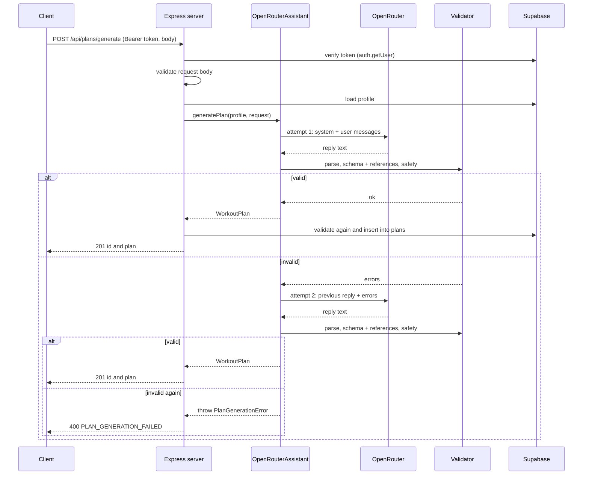

# Plan generation

How the AI service turns a user profile and a request into a validated workout plan. The code is in
`services/assistant/src/providers/openrouter.ts` (class `OpenRouterAssistant`, which implements the
`Assistant` interface from `src/types.ts`).

> Not verified against a live provider: the test suite uses a fake chat client
> (`tests/openrouter.assistant.test.ts`). No real OpenRouter call was made while writing this document.

## Integration

- OpenRouter has an OpenAI-compatible API, so the service uses the `openai` npm package with
  `baseURL` set to `https://openrouter.ai/api/v1` (a constant in the source, not an env var).
- The API key comes from `OPENROUTER_API_KEY`, the model id from `OPENROUTER_MODEL`
  (default `anthropic/claude-3.5-sonnet`). See `services/assistant/README.md`.
- One chat completion per attempt, with `temperature: 0.7` and `response_format: { type: "json_object" }`.
- The current implementation does not use tool calls. It sends the whole catalog and the schema in the
  prompt and validates the reply itself. (The tool definitions in `src/tools/` are not wired into this
  provider.)
- Only the OpenRouter provider exists in `services/assistant/src`. The root README also plans an
  Anthropic provider; that is not implemented, and the service does not read `ASSISTANT_PROVIDER`.

## Inputs

- `Profile`: loaded from the `profiles` table for the authenticated user (`getProfile`).
- `PlanRequest`: `duration_days`, `focus_areas` (catalog groups), optional `custom_instructions`.

## Prompts

Two messages start every conversation.

**System prompt** (`buildSystemPrompt`), in this order:

1. Role line: a workout planner for the Aura Fit app.
2. `## Exercise catalog`: the full catalog as JSON (id, group, level, `avoid_if`, and the other fields).
3. `## User profile`: fitness level (1 to 3), goal, minutes per day, injuries (or `none`), age range.
4. `## Safety rules (critical)`:
   1. Never include exercises whose `avoid_if` matches one of the user's injuries.
   2. Only use catalog ids exactly as written.
   3. Only use exercises with level at or below the user's fitness level.
   4. Keep each day within the minutes per day.
5. `## Output format`: return only valid JSON matching the workout plan schema (the full
   `schemas/workout-plan.schema.json` is included), no markdown, no commentary.

**User prompt** (`buildUserPrompt`): number of days, the focus areas (or "none specified"), and the
custom instructions if given.

Rules 3 and 4 are instructions to the model only. The validators check rules 1 and 2 (stages 3 and 2).
Nothing in code checks the level or the minutes. See `validation-flow.md`.

## Retry logic

- `MAX_ATTEMPTS = 2`: the first try plus one retry.
- After each reply the code runs, in order: `parseWorkoutPlan` (JSON parse), `validateWorkoutPlan`
  (schema, references), `validatePlanSafety`. The first stage that fails ends the check and its errors
  are the result. Safety violations become errors with code `INJURY_CONFLICT`; a reply that is not
  JSON becomes one error with code `INVALID_JSON` and path `""`.
- If attempt 1 fails, the conversation continues with two more messages: the model's own reply as an
  `assistant` message, then a `user` message:

  ```text
  Your previous plan failed validation with these errors:
  - [EXERCISE_NOT_FOUND] days[2].blocks[1].items[0].exercise_id: Exercise 'sqaut' not found in catalog
  Return the complete corrected plan as JSON only, with no commentary.
  ```

  Each line is `- [code] path: message`; an empty path prints as `(root)`.
- If attempt 2 also fails, `PlanGenerationError` is thrown with `attempts = 2` and the errors from the
  last attempt only.
- A failed HTTP call to OpenRouter is not retried. It throws `APIError` immediately (provider
  `openrouter`, status taken from the upstream error, or 500).
- Logging: request metadata at info, full request and response bodies at debug.

## Call flow



In the server (`src/api/server.ts`) the order is: authenticate, validate the body, load the profile,
generate (wrapped in a timeout, 55 seconds unless `requestTimeoutMs` is set, so it ends before the app stops waiting at 60), then store the plan.
The timeout does not cancel the work, it only stops the request from waiting (a late result is dropped).
Two attempts to a slow model can pass 55 seconds and return `GATEWAY_TIMEOUT` (504).

## PlanGenerationError

Defined in `src/types.ts`; extends `AppError`.

```ts
class PlanGenerationError extends AppError {
  constructor(
    message: string,                  // "Plan generation failed after 2 attempts"
    public readonly attempts: number, // 2
    public readonly lastErrors: ValidationError[], // errors from the last attempt
  )
  // code: 'PLAN_GENERATION_ERROR', statusCode: 500 (class defaults)
}
```

The HTTP layer does not use the class defaults. `describeError` in `server.ts` maps it to HTTP 400:

```json
{
  "error": "PLAN_GENERATION_FAILED",
  "message": "Plan generation failed after 2 attempts",
  "details": {
    "attempts": 2,
    "validation_errors": [
      { "path": "days[0].blocks[1].items[0]", "message": "Exercise 'squat' conflicts with injury 'knee_injury'", "code": "INJURY_CONFLICT" }
    ]
  },
  "correlationId": "<uuid>"
}
```

`validation_errors` is the `lastErrors` array. The example entry is illustrative of the shape; the
message format for `INJURY_CONFLICT` is taken from `checkCandidate` in `openrouter.ts`.
