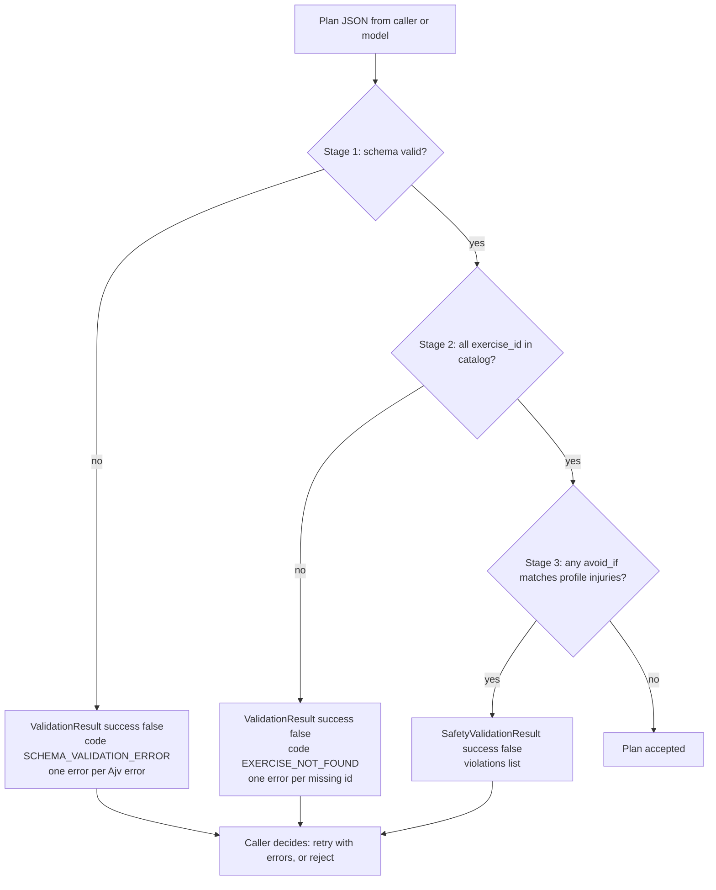

# Validation flow

Every workout plan goes through three checks before it is accepted. The checks run in a fixed order
and are cheap, deterministic functions. They live in `services/assistant/src/validator/validate.ts`.

| Stage | What it checks | Function | Failure code |
|---|---|---|---|
| 1. Schema | Shape, types, required fields, formats, `additionalProperties: false` | `validateWorkoutPlan` | `SCHEMA_VALIDATION_ERROR` |
| 2. References | Every `exercise_id` exists in `catalog/exercises.json` | `validateWorkoutPlan` | `EXERCISE_NOT_FOUND` |
| 3. Safety | No exercise has an `avoid_if` entry that matches the user's `injuries` | `validatePlanSafety` | none (returns violations) |

Stages 1 and 2 are one function call, `validateWorkoutPlan(plan, catalog)`. Stage 3 is a separate call,
`validatePlanSafety(plan, profile, catalog)`, because it needs the user's profile.

## Stage details

**Stage 1, schema.** The plan is checked with Ajv (draft 2020-12, `allErrors: true`, `strict: true`,
plus `ajv-formats`) against `schemas/workout-plan.schema.json`. All schema errors are collected, not just
the first. If this stage fails, stage 2 does not run.

**Stage 2, references.** The code walks `days -> blocks -> items` and checks each `exercise_id` against
the catalog. All missing ids are reported. It only runs on a plan that already passed stage 1, so the
tree shape can be trusted.

**Stage 3, safety.** The code walks the same tree. For each item it looks up the exercise and checks
whether any entry in its `avoid_if` is in `profile.injuries`. Each match is one violation. An
`exercise_id` that is not in the catalog is skipped here (stage 2 reports it).

The schema does not check that `minutes` matches the exercises in the day, and no stage compares
`level` with the user's fitness level. The generator prompt asks the model for both (see
`plan-generation.md`), but no validator enforces them.

## Flow



What the callers do with a failure:

- **Plan generation** (`providers/openrouter.ts`): runs all three stages on the model output. Safety
  violations are turned into `ValidationError` objects with code `INJURY_CONFLICT`. The errors go back
  to the model once. If the second attempt also fails, `PlanGenerationError` is thrown. A reply that is
  not JSON is reported with code `INVALID_JSON` (from `parseWorkoutPlan`).
- **Saving a plan** (`tools/database.ts`, `savePlan`): runs stages 1 and 2 only, and throws
  `ValidationErrorClass` (code `VALIDATION_ERROR`, HTTP 400) if the plan is invalid. It does not run
  stage 3, because it does not load the profile.
- **The `validate_plan` tool** (`tools/validation.ts`) exists for the tool-call design, but the current
  OpenRouter provider does not use tool calls.

## Result shapes

Defined in `services/assistant/src/types.ts`.

```ts
interface ValidationResult {
  success: boolean;
  errors: ValidationError[];      // empty when success is true
}

interface ValidationError {
  path: string;                   // e.g. "days[0].blocks[1].items[2].exercise_id"
  message: string;                // human-readable
  code: string;                   // for code to branch on
}

interface SafetyValidationResult {
  success: boolean;
  violations: SafetyViolation[];  // empty when success is true
}

interface SafetyViolation {
  exercise_id: string;            // the exercise that conflicts
  injury: string;                 // the injury identifier that matched
  location: string;               // e.g. "days[0].blocks[1].items[0]"
}
```

### Paths

Paths are JSON-path-like strings. Ajv's JSON pointer (`/days/0/blocks/1`) is converted to
`days[0].blocks[1]`. When the error is on the plan object itself (for example a missing top-level
field), Ajv gives an empty pointer and the path is the string `root`.

### Error codes in the validator

| Code | Where | Meaning |
|---|---|---|
| `SCHEMA_VALIDATION_ERROR` | `validate.ts` | Any Ajv schema error |
| `EXERCISE_NOT_FOUND` | `validate.ts` | `exercise_id` not in the catalog |

The `SCHEMA_VALIDATION_ERROR` messages are rewritten for these Ajv keywords: `required`
("Missing required field: X"), `type` ("Invalid type: expected T"), `enum`, `minimum`
("Value must be >= N"), `minItems`, `pattern` and `format`. Other keywords keep the Ajv message.

## Example output

The outputs below were produced by running the validators on `examples/plans/beginner-3day-plan.json`
after changing it, or on the unchanged plan with a different profile.

### Stage 1 failure (goal removed, `days[0].minutes` set to 0, a `sets` value made a string)

```json
{
  "success": false,
  "errors": [
    { "path": "root", "message": "Missing required field: goal", "code": "SCHEMA_VALIDATION_ERROR" },
    { "path": "days[0].minutes", "message": "Value must be >= 1", "code": "SCHEMA_VALIDATION_ERROR" },
    { "path": "days[1].blocks[0].items[0].sets", "message": "Invalid type: expected integer", "code": "SCHEMA_VALIDATION_ERROR" }
  ]
}
```

### Stage 2 failure (an `exercise_id` misspelled as `sqaut`)

```json
{
  "success": false,
  "errors": [
    {
      "path": "days[2].blocks[1].items[0].exercise_id",
      "message": "Exercise 'sqaut' not found in catalog",
      "code": "EXERCISE_NOT_FOUND"
    }
  ]
}
```

### Stage 3 failure (the beginner plan checked against `examples/profiles/intermediate-knee-injury.json`)

```json
{
  "success": false,
  "violations": [
    { "exercise_id": "squat", "injury": "knee_injury", "location": "days[0].blocks[1].items[0]" },
    { "exercise_id": "jumping-jacks", "injury": "knee_injury", "location": "days[1].blocks[1].items[0]" },
    { "exercise_id": "squat", "injury": "knee_injury", "location": "days[2].blocks[1].items[0]" }
  ]
}
```

## Request validation (a separate check)

`POST /api/plans/generate` validates its request body with `validatePlanRequest`
(`services/assistant/src/api/validation.ts`) before any plan work starts. It returns
`ValidationError` objects with these codes: `INVALID_BODY`, `INVALID_DURATION`, `INVALID_FOCUS_AREAS`,
`TOO_MANY_FOCUS_AREAS` (more than 10), `INVALID_FOCUS_AREA` (not one of the catalog groups),
`INVALID_CUSTOM_INSTRUCTIONS`, `TOO_LONG` (more than 500 characters). Example for
`{ "duration_days": 0, "focus_areas": ["legs"] }`:

```json
[
  { "path": "duration_days", "code": "INVALID_DURATION", "message": "duration_days must be a positive integer" },
  { "path": "focus_areas[0]", "code": "INVALID_FOCUS_AREA", "message": "Unknown focus area; use one of: warm_up, lower_body, upper_body, core, cardio" }
]
```

The server wraps these as `details` in a `VALIDATION_ERROR` response (HTTP 400). See
`services/assistant/README.md`.
